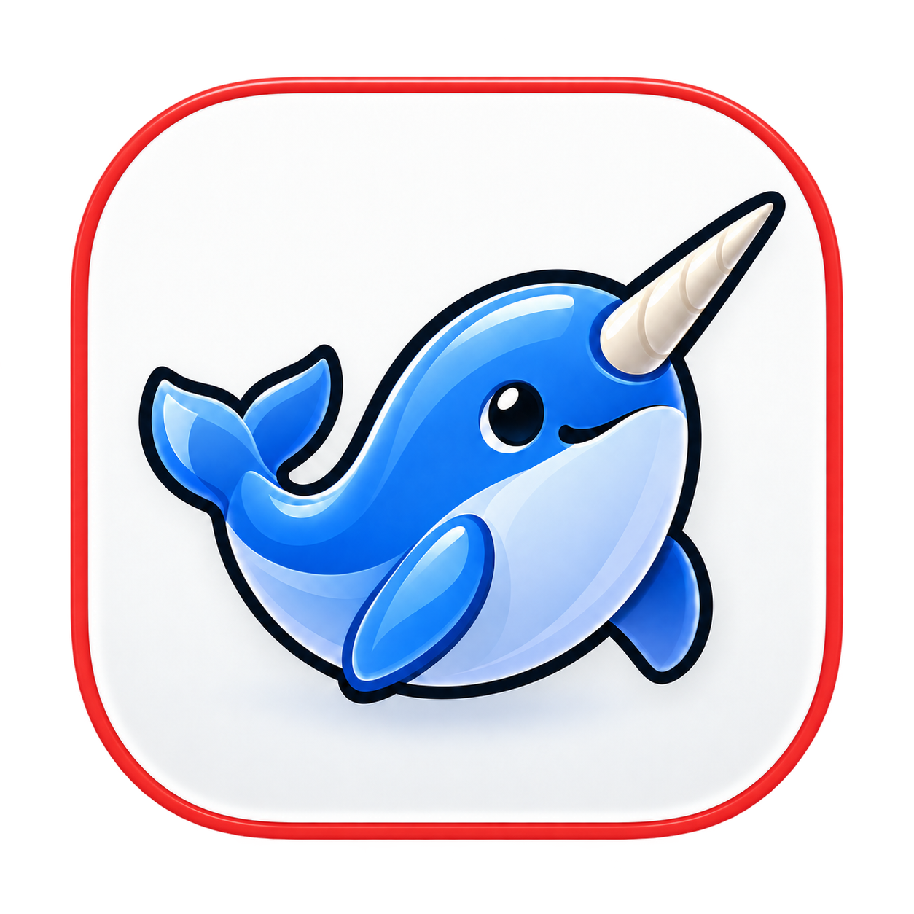

  

<h1 align="center">Narly</h1>

Your links. The right place. A native macOS app that lets you choose where each link opens.

## Download

Download the latest DMG from [Releases](https://github.com/andreasvillumsen/narly/releases).
Narly requires **macOS 26.0 or newer** and an **Apple Silicon** Mac.
Releases are ad hoc signed and are not Apple-notarized.

Quit Narly, open the DMG, and drag Narly to Applications.
If macOS blocks a download you trust, use its per-app **Open Anyway** option in
System Settings → Privacy & Security. Do not disable system security globally.

## Use Narly

Open Narly and choose **Set as default browser** in Settings. Then open a web link
from another app and choose its destination. Arrange your browsers, add installed
apps, hide destinations and assign shortcuts in Settings.

- List and horizontal picker layouts, with native Liquid Glass.
- Type part of an app’s name to find it; Return opens the selection.
- Arrow keys and Tab move between apps. Hold Option to reveal app shortcuts.
- Click the link or press Command-C to copy it. Escape clears search or dismisses the picker.
- Links queue in order; dismissed links can be restored from the menu bar while Narly is running.
- Supported app links can open in Slack, Figma, Linear, Notion, Zoom, Teams and Spotify.
- Choose a browser to open browser-only links automatically, or keep asking every time.
- Show the picker for the next link from the menu bar or with a configurable global shortcut.
- Check for updates in Settings → About and choose a browser to download a newer release.
- English and Danish, VoiceOver support and optional launch at login.

No analytics or uploaded link history. Preferences stay on your Mac. Technical
diagnostic logs exclude URLs, domains and window titles. Automatic updates,
browser profiles and private-browsing selection are not included.

The manual update check contacts GitHub, which receives your IP address. Your links
and app preferences are not sent. Updates are downloaded and installed manually.

## Build from source

Requires Xcode with the macOS 26+ SDK on Apple Silicon. Run `bash scripts/test.sh`
for automated tests, then `bash scripts/package-dmg.sh` to create a local DMG.
For development, run `./script/build_and_run.sh --verify` to use Narly Dev with
separate preferences. Run build and test commands sequentially.
